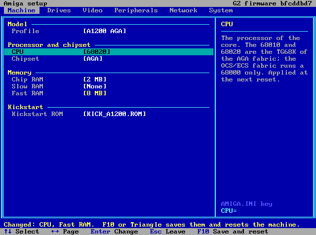
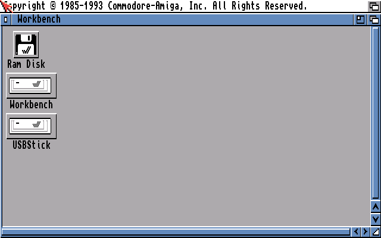
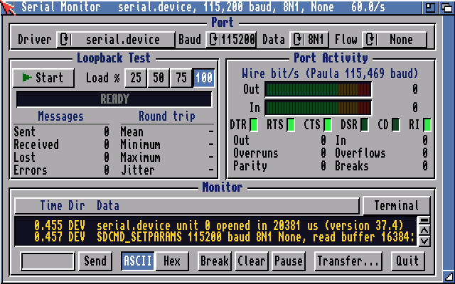
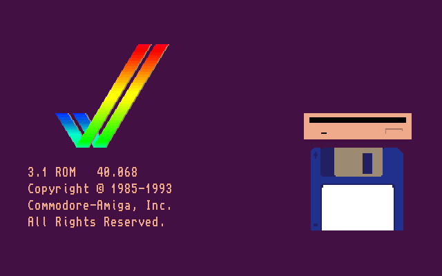
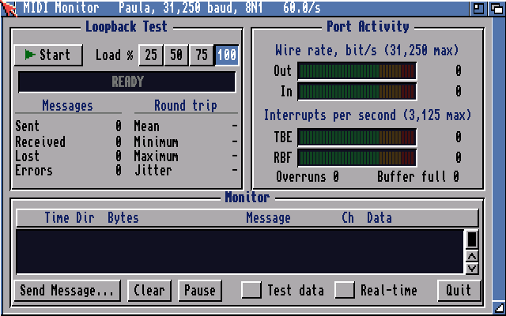
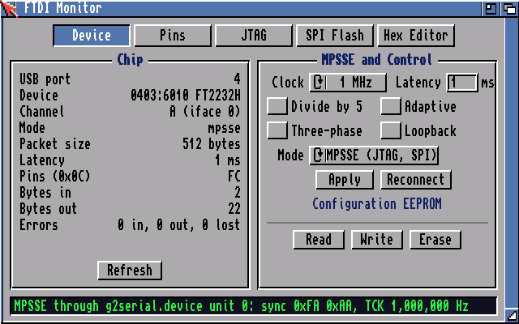

# Amiga Computer Core for the Pano Logic G2 Revision C

**An A1200-class Amiga in the Xilinx Spartan-6 XC6SLX100 of a Pano Logic Zero Client G2 revision C: the TG68K 68020 with a 2-way cache, the Minimig AGA chipset, 2 MB of chip and 8 MB of fast memory in DDR2, four floppy drives and two IDE hard disks from images on a USB stick, Toccata 16-bit sound, an X-Surf 100 network board, a serial FIFO board, USB keyboard, mouse and two DualShock pads, run by a RISC-V firmware on the same fabric with a menu-driven setup screen. Written to the unit's main flash slot over the network with tnpflash; the unit's stock firmware stays in its golden image.**

<b>Figure 1.</b> The setup screen (F12), page Machine: every AMIGA.INI key is an item; changed values are yellow until F10 saves them. Drawn by the firmware's own setup code on a host model of its text console.

&nbsp;&nbsp;

<b>Figure 2.</b> Workbench 3.1 from a hard-disk image, with the USBStick volume. <b>Figure 3.</b> serialmon. Frames of the unit's video capture, NTSC 640 x 200.

---

## 1 Features

| Machine | Peripherals |
|---|---|
| Minimig AGA chipset (Agnus, Denise, Paula, CIAs, Gary, Gayle); OCS, ECS or AGA | DF0:-DF3: from DD ADF images, held in DDR2, written back 1 s after the last write |
| TG68K as 68000, 68010 or 68020; 4 KB instruction and 4 KB data cache, 2-way | HD0: and HD1: from HDF images on Gayle IDE, 8 MB write-back cache; new images of 128 MB to 1 GB made in setup |
| Profiles A500 OCS, A500+ ECS, ECS 2 MB, A1200 AGA (68020, 8 MB fast RAM) | USBStick: volume on a folder of the stick |
| Chip 512 KB to 2 MB, slow to 1.5 MB, fast to 8 MB | USB boot keyboard and mouse (low or full speed); two DualShock 4 or DualShock 3 pads on the two game ports |
| NTSC 28.636364 MHz or PAL 28.375160 MHz core clock from an NCO | Paula and Toccata (AD1848) mixed at 48 kHz into the WM8750BL codec; AHI driver |
| Picture captured at 640 samples a line, triple-buffered, shown at 640 x 480 on DVI-I (VGA) and micro-HDMI | X-Surf 100 (NE2000) board; PanoTCP: bsdsocket.library on the firmware's TCP/IP stack |
| Battery clock loaded from network time | Paula's serial port and a serial FIFO board on an FTDI adapter (0 lost to 500,000 baud); USB-MIDI |
| Setup screen: six pages, 48 items, keyboard or pad | FT2232H MPSSE port for JTAG and SPI flash programs |
| Firmware loaded from the stick: an update is a file copy | 86 % of the XC6SLX100 slices, all timing constraints met |

## 2 General Description

The Pano Logic Zero Client G2 is a thin client built around a Xilinx XC6SLX100-2FGG484 (revision C) with two 64 MB
DDR2 parts, a USB3300 ULPI PHY behind a USB2514 four-port hub, a Marvell 88E1119R Ethernet PHY, two Chrontel CH7301C
video encoders (DVI-I and micro-HDMI), a Wolfson WM8750BL codec and an 8 MB M25P64 configuration flash.

The fabric holds two machines. The Amiga is the NanoMig port of the Minimig AGA chipset with the TG68K CPU, converted
to Verilog-2001 for XST and clocked from the 50 MHz system clock through a clock gate at the Amiga's own rate; its
chip, slow and fast memory and its Kickstart live in DDR2 behind fabric caches. A VexiiRiscv RISC-V SoC runs the
firmware: it owns the USB host, the stick, Ethernet, the video heads and the codec, and through one register page it
serves the Amiga's disk sectors, keyboard, mouse and joysticks, captured picture, sound, network frames and serial
bytes. The firmware draws the setup screen on both video heads while the Amiga is stopped.

The release is written once into the main flash slot (0x380000) by tnpflash, which talks to the unit's stock firmware
over the network. The multiboot header, the golden image (the stock firmware) and the configuration table with the
unit's MAC address are never written; a main slot that fails to configure starts the golden image.

<b>Figure 4.</b> Kickstart 3.1 (40.068) waiting for a disk: one captured frame, 640 samples x 200 lines (NTSC), each line shown twice.

## 3 Release 1.0

The release files are on the [v1.0 release page](https://github.com/mikewolak/pano-g2-amiga/releases/tag/v1.0);
`SHA256SUMS` lists the sha256 of each.

| File | Content |
|---|---|
| `pano-g2-amiga-1.0-slot.bin` | Main flash slot image: the Amiga fabric (3,145,728 bytes) followed by its loader; written by `tnpflash g2write` |
| `pano-g2-amiga-1.0-stick.zip` | The stick's `\amiga` directory: `AMIGA.FW`, a sample `AMIGA.INI`, `G2TOOLS.adf` |
| `AMIGA.FW` | The firmware, 316,164 bytes, ID 0xBFCDDBD7 |
| `G2TOOLS.adf` | DD floppy image with the AmigaOS programs and their Install script |
| `pano-g2-amiga-1.0-amiga-programs.zip` | The same programs as plain files (C, DEVS, L) |
| `pano-g2-amiga-1.0-fabric.bin`, `pano-g2-amiga-1.0-loader.img` | The two parts of the slot image, for JTAG or other flash tools |
| `tnpflash-macos`, `tnpflash-linux-x86_64`, `tnpflash-linux-arm64`, `tnpflash-windows.exe` | tnpflash, built from `tnpflash/` |
| `G2_AMIGA_SETUP_GUIDE.pdf` and twelve data sheets | Section 8 |

| Part | Build | Implementation |
|---|---|---|
| Fabric | ISE 14.7, G2_AMIGA_AGA, PAR cost table 7, build ID 0x0AB5EF2D | 13,730 of 15,822 slices, 176 of 268 RAMB16, 34 DSP48A1; worst setup slack 0.334 ns at 20 ns |
| Loader | RISC-V, at flash 0x680000 | Starts `\amiga\AMIGA.FW` from the stick |
| Firmware | RISC-V GCC, `-march=rv32im_zicsr_zifencei -Os` | ID 0xBFCDDBD7 |
| AmigaOS programs | m68k-amigaos-gcc 6.5.0b, 68020 | Section 6 |

## 4 Installation

The procedure, with every message tnpflash prints, is in `G2_AMIGA_SETUP_GUIDE.pdf`. In short:

1. Format a USB stick FAT32 or exFAT and unpack `pano-g2-amiga-1.0-stick.zip` at its top. Add a Kickstart image as
   `\amiga\KICK_A1200.ROM` (3.1) or `\amiga\KICK.ROM`, and disk images (`*.adf`, `*.hdf`) to `\amiga`.
2. Connect the unit, with its stock firmware, to a network with DHCP; power it.
3. `tnpflash discover` lists the unit's address. `tnpflash info <ip>` must print
   `G2 rev C (LX100, M25P64) -- g2write accepts this unit`.
4. `tnpflash backup <ip> g2-<mac>.bin`: the whole 8 MB flash, read twice and compared. Keep the file.
5. `tnpflash g2write <ip> g2-<mac>.bin pano-g2-amiga-1.0-slot.bin`: the main slot only, erased, programmed and read
   back (about 700 s). It ends with `written and verified`.
6. Power-cycle the unit with the stick, a monitor, a keyboard and a mouse attached. F12 opens setup.
7. The sample AMIGA.INI puts `G2TOOLS.adf` in DF1:; run `Execute G2Tools:Install` in a Workbench Shell.

## 5 tnpflash

tnpflash backs up, verifies and writes the flash of a Pano Logic G2 revision C that runs its stock firmware, through
that firmware's own network protocol (UDP 8321). No Pano Logic software is used or shipped. It is C99 with no
dependency beyond the C library and the socket API.

| Command | Function |
|---|---|
| `tnpflash discover [-b ip]... [-l local-ip] [-t secs]` | Broadcast discovery on the local segment: IP, netmask, gateway, MAC, revision |
| `tnpflash info <ip>` | The unit's identity and board type |
| `tnpflash backup <ip> <out.bin>` | The whole flash read twice; the file is written only when both passes agree; sha256 |
| `tnpflash verify <ip> FILE[@0xOFF]...` | Is the flash exactly these files (read only) |
| `tnpflash g2write <ip> <backup.bin> <slot.bin>` | The main slot 0x380000-0x6BFFFF only, after the header and configuration-table sectors are compared with the backup; every word read back |
| `tnpflash reset <ip>` | Clears a session a dead client left open |

| Host | Build | Test |
|---|---|---|
| macOS 11 or later | `xcode-select --install`, then `cd tnpflash && make` | `make test`: 8 passed, 0 failed (macOS 26, Apple silicon) |
| Linux | `sudo apt install build-essential` (or the distribution's gcc and make), then `make` | `make test`: 8 passed, 0 failed (Ubuntu 24.04, arm64) |
| Windows | MSYS2 UCRT64: `pacman -S mingw-w64-ucrt-x86_64-gcc make`, then `make win64 MINGW64=gcc`; or MinGW-w64 on Linux: `make win64` / `make win32` | the 32-bit build under wine: info, backup, g2write and verify against the simulator correct |

`make test` runs tnpflash against `build/tnpsim`, a simulated stock G2 revision C on 127.0.0.1 (`TNPSIM_G2C=1`):
discovery, identification, an 8 MB backup, the refusal of an image without a sync word, the refusal of a backup from
another unit, a 262,144-byte g2write, a verify, and a byte comparison of the simulated flash afterwards (header,
golden image and configuration table unchanged, the slot holding the image). On hardware: `backup` and `g2write`,
the same functions in the full tool these are cut from, wrote the release slot to a G2 revision C; this cut-down
build has run against the simulator only.

## 6 AmigaOS Programs

&nbsp;&nbsp;

<b>Figure 5.</b> midimon. <b>Figure 6.</b> ftdimon, page Device, an FT2232H in MPSSE mode. Frames of the unit's video capture.

| Program | Install | Function | Source |
|---|---|---|---|
| serialmon | C: | Serial port monitor: loopback test, meters, modem lines, monitor, driver switching, file transfers, VT100/VT220 terminal | `amiga/tools/serialmon`, `amiga/tools/term` |
| midimon | C: | MIDI monitor, loopback tester and message sender | `amiga/tools/midimon` |
| ftdimon | C: | FT2232H: device, pins, JTAG chain, SPI NOR flash, hex editor | `amiga/tools/ftdimon`, `amiga/tools/jtag` |
| flashmon | C: | The G2 configuration flash: part, map, read, verify, write, erase, CRC, bitstreams, hex editor | `amiga/tools/flashmon` |
| PanoTCP | C: | bsdsocket.library 4 on the firmware's lwIP | `amiga/panotcp` |
| PANOFS | C: | Inhibits DH0: while the firmware writes into its image | `amiga/panofs` |
| lsz, lrz | C: | ZMODEM, YMODEM, XMODEM (lrzsz 0.12.20) | `amiga/tools/xfer` |
| share-handler | L: | The USBStick: volume | `amiga/share` |
| g2serial.device | DEVS: | serial.device commands on the serial FIFO board or Paula | `amiga/serial` |
| panoflash.device | DEVS: | The configuration flash through HD0's flash window | `amiga/panoflash` |
| g2.audio, G2 | DEVS:AHI, DEVS:AudioModes | AHI driver and mode file for the Toccata path | `amiga/ahi/g2` |

Build: `make` in each directory with m68k-amigaos-gcc 6.5.0b (bebbo amiga-gcc) in `~/opt/amiga/bin`; `amiga/panofs`
with vasm and the AmigaOS 3.2 NDK; `amiga/g2tools/mktar.sh` collects the built files for the tools floppy.

## 7 Repository Contents

| Path | Content |
|---|---|
| `tnpflash/` | The flash tool, its simulator and tests |
| `amiga/nanomig/` | NanoMig, unmodified (revision `a6f0adf`) |
| `amiga/rtl/src/`, `amiga/rtl/gen/`, `amiga/rtl/g2/` | Edited core files (`amiga/THIRD_PARTY.md`), the Verilog-2001 conversion, the G2 Amiga subsystem |
| `amiga/Makefile`, `amiga/tools/v2001_fix.py`, `xst_scan.py` | The conversion of the core with sv2v 0.0.13 and its checks |
| `amiga/tools/`, `amiga/serial/`, `amiga/ahi/`, `amiga/panofs/`, `amiga/panoflash/`, `amiga/panotcp/`, `amiga/share/`, `amiga/g2tools/` | The AmigaOS programs and drivers |
| `amiga/third_party/` | libvterm 0.3.3, lrzsz 0.12.20, flashrom 1.4.0 chip table, ftdiflash, fpga-toccata, the Minimig-AGA Ethernet model |
| `rtl/` | The G2 SoC: top level, VexiiRiscv core, MCB DDR2 ports, video heads, audio path, Ethernet MAC, SPI flash and recovery |
| `ise/` | ISE 14.7 project files, constraints, the build script `ise/build_g2.sh` |
| `fw/`, `fw/amiga/` | The RISC-V firmware: setup screen, sector server, input, video, audio, network console, X-Surf relay, socket service |
| `fatfs/`, `adflib/`, `fw/third_party/lwip/` | FatFs R0.16, ADFlib 0.10.7, lwIP 2.2.0 |
| `tools/panoldr/` | The flash payload header and its packer |
| `docs/img/` | The figures of this file |

### 7.1 Source not included

The fabric contains a licensed Xilinx IP core, the XPS USB Host Controller (xps_usb_host v1.01.a, a fee-based EDK
core distributed as an encrypted netlist under the Xilinx licence). That core, the fabric's USB host bridge and its
ULPI split-token patch, and the firmware's USB host and class drivers (EHCI, hub, mass storage, HID, DualShock,
USB-MIDI, FTDI) are not distributed in source form. Without them the fabric builds with no USB host
(`rtl/g2/pano_g2_top.v` ties the port off) and the firmware does not link; the release binaries are built from the
complete tree. Everything else that the release binaries are built from is in this repository.

## 8 Documents

| File | Content |
|---|---|
| `G2_AMIGA_RELEASE_1.0.pdf` | The release: configurations, implementation, measured figures, every file with its sha256 |
| `G2_AMIGA_SETUP_GUIDE.pdf` | From a factory unit to a running Amiga: files, tnpflash, stick, first start, programs, settings, updates, the way back |
| `G2_AMIGA_TECHNICAL_REFERENCE.pdf` | Architecture, clocks, memory maps, the RISC-V to Amiga register page and protocols, boot chain, buffer sizes, performance |
| `G2_SETUP_SCREEN.pdf` | The setup screen: keys, pages, every item, pop-ups, when a change takes effect |
| `G2_INPUT_JOYSTICK.pdf` | Keyboard map, mouse, DualShock pads and the game ports |
| `G2_USB_HOST.pdf` | The USB host, hub ports and device classes |
| `G2_STORAGE.pdf` | Floppy and hard-disk images, the cache, USBStick:, the reserved blocks of HD0 |
| `G2_VIDEO.pdf`, `G2_AUDIO.pdf` | Picture capture and outputs; Paula, Toccata, AHI |
| `G2_NETWORK.pdf` | Network console, X-Surf 100, PanoTCP |
| `G2_SERIAL_MIDI.pdf`, `G2_FT2232H_PORT.pdf` | Serial port, serial FIFO board, MIDI; the FT2232H MPSSE port |
| `G2_AMIGA_PROGRAMS.pdf` | The AmigaOS programs with screen captures |

## 9 Basis and Components

| Component | Author | Revision | Licence |
|---|---|---|---|
| NanoMig (Minimig AGA chipset, glue) | MiSTle-Dev, Till Harbaum; Dennis van Weeren, Rok Krajnc, MiSTer contributors | `a6f0adf` | GPL-3.0 or later (file headers) |
| TG68K | Tobias Gubener | NanoMig copy | GPL / LGPL (file headers) |
| FX68K | Jorge Cwik | NanoMig copy | GPL-3.0 |
| fpga-toccata | ranzbak, via MiSTer Minimig-AGA | `e47c345` | BSD-2-Clause |
| Minimig-AGA Ethernet model | Minimig-AGA contributors | vendored copy | GPL (file headers) |
| VexiiRiscv | Charles Papon | `42268af` | MIT |
| Spartan-6 MIG memory controller files | Xilinx, Inc. | ISE 14.7 | Xilinx licence (file headers) |
| FatFs | ChaN | R0.16 | FatFs licence (BSD-style) |
| lwIP | Adam Dunkels and contributors | 2.2.0 | BSD-3-Clause |
| ADFlib | ADFlib authors | 0.10.7 | LGPL-2.1 |
| libvterm | Paul Evans | 0.3.3 | MIT |
| lrzsz | Uwe Ohse, Chuck Forsberg | 0.12.20 | GPL-2.0 |
| flashrom chip table | flashrom project | 1.4.0 | GPL-2.0-or-later |
| ftdiflash | Clifford Wolf (iceprog); Dean Miller, Adafruit Industries | `242ae956` | ISC |
| a314fs (SHARE: handler and server) | Niklas Ekstrom | `bab2b8a` | CC0-1.0 |
| AHI driver sources | Martin Blom | AHI 6.0 | `amiga/ahi/g2/COPYING.DRIVERS` |
| XPS USB Host Controller (in the release fabric only) | Xilinx, Inc. | xps_usb_host v1.01.a | Xilinx licence, fee-based EDK core |
| G2 fabric, firmware, drivers, programs, tnpflash, setup screen | Mike Wolak, EPROM Foundry Inc. | release 1.0 | Section 10 |

## 10 Licence

| Files | Licence |
|---|---|
| Files whose header names `PolyForm-Noncommercial-1.0.0`: the fabric, firmware, tnpflash, serialmon, midimon, PanoTCP, the drivers and their build files | PolyForm Noncommercial License 1.0.0 (`LICENSE`): use, change and distribution for any non-commercial purpose |
| Files whose header names `GPL-2.0-or-later`: ftdimon and the files built into it, flashmon, panoflash.device, the lrzsz glue | GNU General Public License version 2 or later (`LICENSES/GPL-2.0.txt`) |
| Third-party files | Their own licence, as section 9 and each file's header state; texts in `LICENSES/` and the third-party directories |
| Release binaries | The licence of the sources they are built from |

Copyright (c) 2026 Mike Wolak, EPROM Foundry Inc. Commercial use of the PolyForm-licensed parts needs a separate
licence from EPROM Foundry Inc. Pano Logic is a trademark of its owner; Amiga, AmigaOS and Kickstart are trademarks
of their owners. No Kickstart, AmigaOS or Workbench file is part of this repository or its releases.

## 11 Limits and Untested Items

| Item | State |
|---|---|
| FPU | None: the TG68K traps F-line opcodes |
| CPU bus | 16-bit, as a 68000; chip memory through the chip bus |
| 31 kHz Amiga modes, `VIDEO=NATIVE` 15 kHz output | Simulated; untested on hardware |
| A PAL screen on an NTSC-configured machine | 240 lines shown: set Region PAL |
| Returning a unit to its stock main slot with g2write | Untested |
| SWD on an STM32 (`amiga/tools/jtag` swdtool) | Untested: no target wired |
| USB MIDI on the release fabric | Not repeated since Paula's receive path changed |
| Recording through the Toccata | Not supported |
