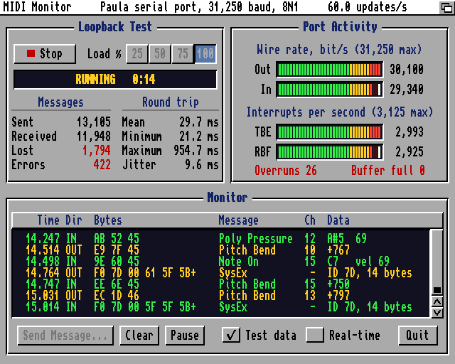
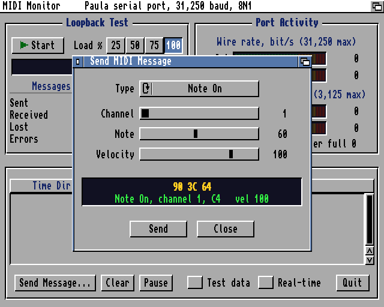
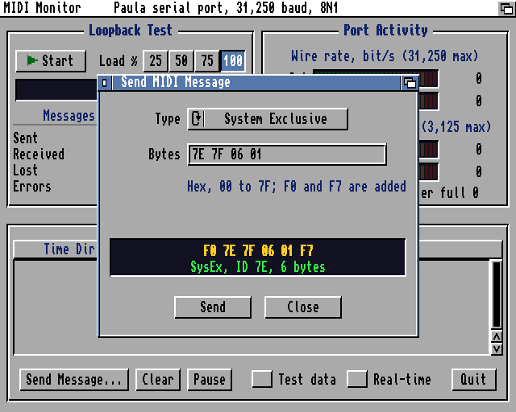
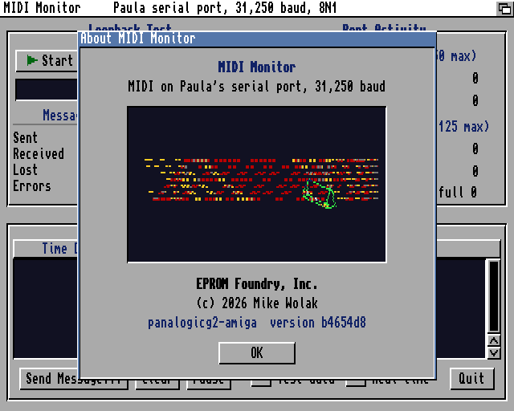

# midimon: MIDI on Paula's Serial Port

**An AmigaOS 3 program for the NanoMig Amiga core on the Pano Logic G2: a loopback test of the MIDI path at 25, 50, 75 or 100 % of 31,250 baud, port activity meters updated 60 times a second, a panel that sends any channel message, system exclusive message or raw bytes, a monitor of both directions, and an About box animated by the Amiga's DMA. Mike Wolak, EPROM Foundry Inc., pano-g2-amiga.**

<b>Figure 1.</b> The main window during a loopback test at 100 % load with test data shown in the monitor; 60.0 display updates a second (screen title). Captured from the screen bitmap on a G2 revision C unit: the losses shown are those of that fabric's 16-byte MIDI receive FIFO (section 7).

---

## 1 Function

| Part | Description |
|---|---|
| Loopback test | Numbered messages out of Paula's serial port and back through the USB-MIDI device's DIN loop; sent, received, lost, errors, round trip mean, minimum, maximum and jitter; PASS or FAIL at the end |
| Port activity | Wire rate out and in (bit/s, full scale 31,250) and TBE and RBF interrupts a second (full scale 3,125): 36-segment bars from a 250 ms window with a 1 s peak hold, figures from a 1 s window; Paula receive overruns and receive-buffer overflows |
| Send panel | Note On, Note Off, Poly Pressure, Control Change, Program Change, Channel Pressure, Pitch Bend (sliders), System Exclusive or raw bytes (hex field); the encoded bytes and their decoding shown before sending; modal |
| Monitor | Both directions decoded (time, direction, bytes, message, channel, data), a 200-line history with a scroller; test data sampled at 20 lines a second; real-time messages optional; pause |
| About box | Program name, function, EPROM Foundry, Inc., copyright, version (the git hash built from), and a panel with a turning logo, an orbiting wireframe cube and a starfield, all played by DMA at the display's 50 frames a second (section 6) |

&nbsp;&nbsp;

<b>Figure 2.</b> The send panel shows only the controls its message type uses. <b>Figure 3.</b> System exclusive: hex data bytes, F0 and F7 added. Screen-bitmap captures.

## 2 Use

| Item | Value |
|---|---|
| Build | `make` in this directory on a host with `m68k-amigaos-gcc` (bebbo, libnix): `-m68020 -O2`, `GIT_HASH` from `git rev-parse --short HEAD` |
| Command line | `midimon [START] [RATE=25\|50\|75\|100] [SECONDS=N]`; with `SECONDS` the test stops after N seconds and the program quits and prints its result |
| Keys, main window | Space or S start and stop the test, 1 to 4 set the load, M send panel, C clear the monitor, P pause it, T test data in the monitor, R real-time messages, A About box, Q or Esc quit |
| Keys, send panel | Return or S send, Esc or C close, T step the message type, B the hex field |
| Requires | AmigaOS 3.0 or later, a 68020, the serial port free (serial.device is expunged when nothing has it open) |

## 3 Hardware Use

| Resource | Use |
|---|---|
| misc.resource | `MR_SERIALPORT` and `MR_SERIALBITS` held while the program runs |
| SERPER | 113 on PAL (31,113 baud, -0.44 %), 114 on NTSC (31,126 baud): the nearest rate at or below 31,250, so the stream never outruns a receiver's DIN wire (section 7.2) |
| RBF, level 5 | The program's interrupt vector: each byte and its time into a 4,096-byte ring |
| TBE, level 1 | The program's interrupt vector: the next byte from a 4,096-byte ring into SERDAT, bytes back to back |
| Vertical blank | A server first in the chain: the frame count of the clock (section 3.1) and the About box's frame signal |
| timer.device | `UNIT_WAITECLOCK`: the 60 Hz display updates; in the About box, the copy timed to the line after the panel |
| Screen | A custom screen in the Workbench's display mode, 16 colours, topaz 8 |
| Sprites 2 to 7 | The About box's starfield, each reused down the panel by its DMA list |
| Blitter | The About box: cube edges in line mode, clears and copies, owned by the task (`OwnBlitter`) |
| Copper | The About box: a user copper list shading the logo line by line and setting the panel's colours |

### 3.1 The Clock

Time is counted in PAL scan lines, 64 us each: the beam's line (VPOSR and VHPOSR read as one longword) plus 313 lines for every vertical blank the program's server has counted. A reading near the top of a frame whose vertical blank is still pending (INTREQR) counts that frame already. The RBF and TBE handlers stamp each byte with this clock; the round trip of the loopback test is the time from the TBE handler's write of a message's status byte to the RBF handler's receipt of it.

## 4 Loopback Test

| Item | Value |
|---|---|
| Message s (modulo 2^17) | s mod 32 = 31: `F0 7D s[20:14] s[13:7] s[6:0]`, eight data bytes (5s + 13i) mod 128, `F7` (14 bytes); otherwise Note On, Poly Pressure and Pitch Bend in turn, channel s[3:0], data s[10:4] and 40h \| s[16:11] |
| Rate | A token bucket from the E clock: 3,125 bytes a second times the load, at most 250 ms of bytes in hand |
| Lost | A gap in the sequence numbers below 1,024; at the end, every message sent and not received intact |
| Errors | A malformed or out-of-order message, Paula receive overruns, receive-buffer overflows |
| PASS | No message lost, no error, no overrun |

## 5 Display and its Budget

The program draws within 16.7 ms an update. The costs, measured on a G2 revision C unit with the E clock:

| Operation | Time |
|---|---|
| `Text()`, 72 characters / 9 characters | 5.6 ms / 1.35 ms |
| `ScrollRaster()`, 584 x 56 pixels, 4 bitplanes | 12.2 ms |
| `RectFill()`, small | 0.56 ms |
| libnix `sprintf` | about 1 ms |

| Rule | Effect |
|---|---|
| Meter bars every update; readouts (figures, table values, counters, scroller) one an update in turn | A readout changes about 4 times a second, the rate of a meter's figures |
| Only the characters of a value that changed are drawn, over the old ones | One short `Text()` instead of a clear and a full redraw |
| Meter segments drawn in runs through an area pattern with every fourth column clear | One `RectFill()` a run of segments of one colour |
| The monitor: at most one scroll or one 72-character row an update; scrolls at most twice a second | 60 updates a second at 100 % load with test data shown |
| 32-bit arithmetic and no `sprintf` in anything run every update | |

Measured: 60.0 updates a second at 100 % load with the monitor showing test data (Figure 1).

## 6 The About Box

<b>Figure 4.</b> The About box, captured from the screen bitmap through the screen's base palette: the copper's shading and the sprite starfield are not in such a capture (section 8).

### 6.1 Construction

| Layer | Hardware | CPU work a frame |
|---|---|---|
| Logo: "EPROMFOUNDRY, INC." in the 8x8 font on a turning sphere, front and back | Blitter copies from a chip-RAM cache; copper shading | none after the first turn |
| Cube: wireframe orbiting the sphere, near and far | Blitter copies from the cache | none after the first turn |
| Starfield: sideways parallax, then flight into the field turning slowly, 30 s each | Sprite DMA | position words, and in flight the sort of stars into sprite lists |
| Colours: front over cube over back text; cube over or under the back text by its depth | Copper per line, colour map per frame | one `SetRGB4` when the order changes |

Each element has its own bitplane over the panel's colour (pen 4, bitplane 2): the cube bitplane 0, the logo's back bitplane 1, its front bitplane 3. The copper list gives every combination its colour on every line of the panel.

The animation repeats every 256 frames: the logo turns 4/1,024 of a turn a frame, the cube turns 4/1,024 about x and 8/1,024 about y and orbits once. Each frame is drawn once into its slot of a 1.03 MB chip-RAM cache during the first turn (the logo's dots by the CPU with 68020 BFSET, the cube's edges by the blitter in line mode), and from then on only played: at the vertical blank the task sets a timer.device request for the line after the panel; at that line it owns the blitter and copies the frame's two logo bands and the cube's window into the panel and clears the cube's previous window. The copies end before the beam returns to the panel. When the cache does not fit in chip RAM, one slot is drawn every frame.

### 6.2 What it Took

| Step | Measured | Cause | Change |
|---|---|---|---|
| 1 | Cube lines outside the panel, a disc of old edges | Projection larger than the panel; no clipping | Scale fitted to the panel |
| 2 | No copper colours or sprites in screenshots | A screen-bitmap capture renders the bitmap through the colour map; the copper and sprite DMA are not in it | The copper list read back from the hardware list; a frame-buffer capture added to the firmware (`snap`, section 8) |
| 3 | Logo and cube drawn by the CPU into off-screen planes and copied by a `QBSBlit` chain | The copies ran at beam lines 20 to 294; the panel is lines 111 to 207 | `QBSBlit` did not hold the chain to its beam line on this system: copies landed while the panel was displayed |
| 4 | Every second frame skipped (292 of 584) | Three full-panel copies with up to four blitter channels took longer than the time below the panel | One bitplane for each element, copies of the logo's 36-line band only |
| 5 | A copper interrupt (COPER) at the line after the panel to start the chain | The signal never arrived (the server's line window began one line late); the closing wait never ended and the Amiga was reset | Removed |
| 6 | Chain at the vertical blank, owned by the task | Ended at beam lines 77 to 156: blits are slow behind a 16-colour hires display | A timer.device request for the line after the panel: ends at lines 9 to 312, outside the panel |
| 7 | All frames drawn, the logo a slide show on the monitor | The clock's frame count advanced only when a reading's line was below the previous one; with no MIDI traffic the only regular reading was the vertical blank's, always about line 0 | The vertical blank server counts frames (section 3.1); the animation runs on that count |
| 8 | Logo 5.4 ms of CPU a frame, cube 17 blits waited on | The logo was ported as the CPU plotter it was | The 256-frame cache: from the second turn three blitter copies a frame |
| 9 | The logo's back side not seen | Drawn at 3/8 of the front's brightness, 2 x 1 pixels | 5/8, and sized by depth one step below the front |
| 10 | The cube cone-like | Eye at 512 units against a cube half-diagonal of 111: near and far faces 1.55 : 1 | Eye at 1,280 (1.19 : 1), scale raised to keep the size |

## 7 Measurements on Unit A

### 7.1 The Machine

`amiga/tools/membench` (E clock, under Forbid; the A1200 profile, 2 MB chip RAM, 8 MB fast RAM, a 16-colour hires screen open):

| Test | Time |
|---|---|
| Two-instruction loop (`subq`, `bne`), code in fast RAM | 463 ns an iteration |
| The same loop, code in chip RAM | 1,772 ns an iteration |
| Fast RAM longword read / write | 935 / 979 ns |
| Chip RAM longword read / write | 1,816 / 1,836 ns |
| CacheControl | 0x00000001: the instruction cache reported on; enabling it again changes nothing |

A four-byte loop four times slower from chip RAM than from fast RAM is fetched from memory at every instruction: the TG68K core runs without an instruction cache, about 4 million instructions a second from fast RAM. SysInfo's figure of 41 MHz is a comparison benchmark and is not this rate. An instruction and data cache in front of the core's DDR2 path is open work.

### 7.2 The MIDI Path

| Finding | Value | Change |
|---|---|---|
| Bytes lost between Paula and the firmware at 25 % load | 112 of 6,251; the MIDI UART's RX overflow bit set | 1,023-byte RX FIFO (fabric 183a7df; fitted, timing met, not yet on the unit) |
| An M-Audio 0763:1050 holding a backlog after full-rate tests | 696 messages; each new OUT packet returned one old message | The firmware paces OUT at one byte a 320 us on average (b4654d8); midimon's SERPER at or below the wire rate |
| Paula receive overruns at full load, with no screenshots | 11 in 91,007 bytes | Open: an interrupt above level 5 holds off RBF for more than one byte time (320 us); the X-Surf driver is suspected, untested |

## 8 Files

| File | Content |
|---|---|
| `midimon.c` | The program |
| `font8x8.c`, `font8x8.h` | The 8x8 character set of the IBM PC XT 286 BIOS (IBM), characters 0x20 to 0x7E, in the arrangement of Mike Wolak, EPROM Foundry Inc.; the turning logo is a port of that project's `bios/mercator.c` |
| `img/` | The figures of this document |

The firmware's `snap [n]` command (fw/amiga/amiga_main.c) saves n consecutive pictures from the video capture to `\amiga\SNAP.RAW` (640 RGB565 samples a line, 288 lines a picture), with copper colours and sprites as displayed. It is built and not yet tested on silicon.
